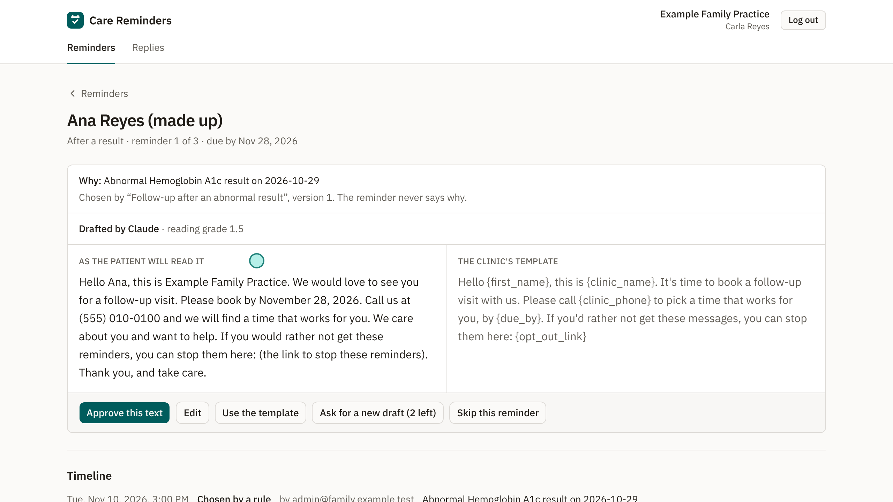

# Care Reminders

Finds a clinic's patients who are due for follow-up care and reminds them, with a person at the clinic approving every reminder: Claude drafts, code checks, the approved text is sent once, reminders stop when the patient replies, books or opts out, and every step is audited.

**Status:** building. M1–M6 (data and fetching; rules and follow-ups; drafts and checks; logins, review and the activity log; sending and stops; measurement) are done, with all 43 acceptance criteria proven ([the evidence page](docs/evidence/m6.html)); M7 (the showcase) is next. See [`AGENTS.md`](AGENTS.md) for the phases and [`docs/architecture.md`](docs/architecture.md) for the build order.

## See it

A 2-minute captioned walkthrough and screenshots are in [`docs/showcase/`](docs/showcase/): the rules choosing who is due, a coordinator approving Claude's draft, the email the patient gets, the opt-out page, the sending caps, a blocked edit, a reply and the activity log.



## What works so far

- **Made-up data:** 25 made-up patients of Example Family Practice, a made-up US primary-care clinic, as FHIR R4 bundles in [`demo/patients/`](demo/patients/). They have lab results, hospital stays, screenings and appointments, and five tricky cases are planted on purpose: a patient who already booked, one who opted out of screening reminders, one who asked not to be emailed, one with a sensitive result, and one discharged too long ago to be due. Every resource carries the HL7 "test health data" label (`HTEST`), and CI fails if a file doesn't, or if anything outside the research documents names a real company (`a1_*`, `a3_*`).
- **Fetching from a FHIR server:** each clinic's patients are fetched from its own FHIR server, by request (`fetch`) and every hour (`work`). Each patient's resources go through a strict reader; one it refuses is skipped with the reason while the others are saved, and nothing is saved twice. Every request has a time limit and every answer a size limit, next pages are followed only on the same server, and a slow, oversized or non-FHIR answer saves nothing and says why. A patient who is gone from the server, or whose newer record was refused, is marked as not current. Every fetch is in the audit log (`h2_*`, `h3_*`). CI runs this against a real HAPI FHIR server (v8.4.0-1).
- **Who is due, by the clinic's own rules:** three rule types with settings (after an abnormal result of a listed test, a screening recall by age and sex, a visit after a hospital discharge). Each finds who is due, by when and why, as plain code with no model call. A patient who already booked, opted out of that kind of reminder, or whose record isn't current is skipped. On the made-up data the default rules choose 40 follow-ups, each planted case getting the outcome it should (`b1_*`).
- **Follow-ups:** each one shows its reason and the rule version that chose it. Changing a rule makes a new version and leaves earlier follow-ups as they were, and fetching again never chooses the same follow-up twice. A follow-up stops when the patient books the visit or opts out later (`b2_*` to `b5_*`).
- **Drafting:** each follow-up's reminders are drafted on days 0, 7 and 21. Each waits until the one before is finished and keeps its gap after a late one, and none is drafted once the follow-up has stopped (`e6_*`). Claude sees only the kind of follow-up, which reminder it is and the clinic's tone: never a name, date or reason (`a2_*`). It writes with fill-ins such as `{first_name}`, which code fills from the clinic's data in one pass (`c6_*`). Its answer is parsed strictly; an answer that can't be read blocks the draft, and when the model doesn't answer, the clinic's template stands in (`c1_*`). Every call is in the cost log.
- **Checks on every draft:** a draft is blocked, with each problem named (`c7_*`), if it has:
  - a fill-in not on the list, or no phone or opt-out link (`c2_*`);
  - a digit, date or time of its own, in any case, short form or script (`c3_*`);
  - a condition, test, specialty, medication or advice, as a plural, possessive or part of a hyphenated word too (`c4_*`);
  - a reading level above 8th grade; above 6th it warns (`c5_*`).

  All 40 hand-written bad drafts in [`evalset/bad-drafts.json`](evalset/bad-drafts.json) are blocked, each by the check it was written to trip (`i1_*`).
- **The care coordinator's review:** staff log in with an emailed link; there are no passwords, and every API needs a login (`h1_*`). The queue lists each reminder waiting, drafts that passed every check first. The review page shows why the patient is due and which rule version chose them, the reminder as the patient will read it beside the clinic's template, and what the checks found. Only the coordinator can approve (`d1_*`). A blocked draft can't be approved (`d2_*`). An approval binds the exact text, and any later change needs approving again; a reminder that can't be filled, or whose follow-up has stopped, can't be approved (`d3_*`). The coordinator's own edits go through the same checks (`d4_*`). The coordinator can use the template or ask for up to two new drafts (`d5_*`), or skip a reminder with a reason (`d6_*`).
- **The activity log:** every step so far is logged with who and when, in an append-only log the database refuses to change (`g1_*`, `g2_*`). Each follow-up has its timeline, and the administrator sees the whole clinic's log, filtered by person and step (`g3_*`). Sending, replies and opt-outs are in it too.
- **Sending:** approving a reminder puts its email into the engine's outbox in the same step, and nothing reaches the outbox without an approval (`e1_*`). It goes exactly once, even if the sender dies between sending and recording, shown by killing the real program at that point (`e2_*`). No patient gets more than one reminder a day or three in any seven days; the extra ones wait (`e3_*`). Reminders go out only 8 am to 6 pm on weekdays, in the clinic's time zone, daylight saving included (`e4_*`). A patient who asked not to be emailed is never emailed, and shows as "contact another way" (`e5_*`). The exact email is checked again just before it goes and refused if it names any care, even through a filled-in name (`e7_*`). The coordinator sees whether each email waits, went, or wasn't sent and why.
- **Stops:** a booking found at the next fetch stops the follow-up and withdraws an approved email that hasn't gone (`f1_*`). A reply, arriving on a signed webhook, stops its follow-up and appears on the Replies page; an automatic reply or a changed reply code stops nothing (`f2_*`). The opt-out link opens a page with one button: opening it changes nothing, and pressing it stops only that kind of reminder (`f3_*`). A changed link is refused (`f4_*`). In the demo, `simulate-reply` stands in for real inbound mail.
- **Measurement:** Claude's draft of every reminder the demo can ask for (3 kinds × reminders 1–3 × 2 tones = 18) is recorded once with the owner's key and replayed in tests and CI. Each must pass every check and fill both before and after its date. Sonnet, which drafts by default, passes 18 of 18 at about US$0.0025 a draft; Haiku passes 13 of 18 at about US$0.0001, each failure being a draft that says "third"; the clinic's template passes 18 of 18 for nothing ([`evalset/report.md`](evalset/report.md) lists every failed draft and why; `i2_*`, `i3_*`).
- **Each clinic sees only its own patients, follow-ups, reminders and activity** (`a4_*`).
- **The evidence pack** links each of the 43 acceptance criteria to the tests that prove it (`j1_*`).

## Try it

```bash
docker compose up -d && docker compose --profile fhir up -d   # Postgres, Mailpit and HAPI FHIR on port 8090
cp .env.example .env
cargo run -- migrate
cargo run -- clinic add --name "Example Family Practice" --email admin@family.example.test
cargo run -- clinic add-coordinator --clinic <the printed ID> --email carla@family.example.test --name "Carla Reyes"
cargo run -- clinic set-phone --clinic <the ID> --phone "(555) 010-0100"
cargo run -- clinic set-time-zone --clinic <the ID> --zone America/New_York   # the default
cargo run -- load-made-up --url http://127.0.0.1:8090/fhir    # only a server on this computer is accepted
cargo run -- clinic set-fhir-server --clinic <the ID> --url http://127.0.0.1:8090/fhir
pnpm --dir web install && pnpm --dir web build
WEB_DIR=web/dist cargo run -- serve   # http://127.0.0.1:3000; login emails arrive in Mailpit at http://localhost:8025
```

Log in as the administrator and press "Fetch from the FHIR server": the rules choose 40 follow-ups and the worker drafts their first reminders (with the clinic's template, unless `OWNER_ANTHROPIC_API_KEY` is set). Then log in as the coordinator to review and approve them. Approved reminders go out in the clinic's sending hours and arrive in Mailpit; open one's link to try the opt-out page. To try a reply:

```bash
cargo run -- simulate-reply --clinic <the ID> --patient p01 --text "Thanks, I'll call on Monday."
```
 `cargo nextest run` runs the tests; `pnpm --dir web e2e` runs the browser tests against a running server.

Made-up clinic, made-up patients: this repository contains no real patient data and names no real company.

## Licence

All rights reserved ([LICENSE](LICENSE)). The source is published to be read, not reused.
